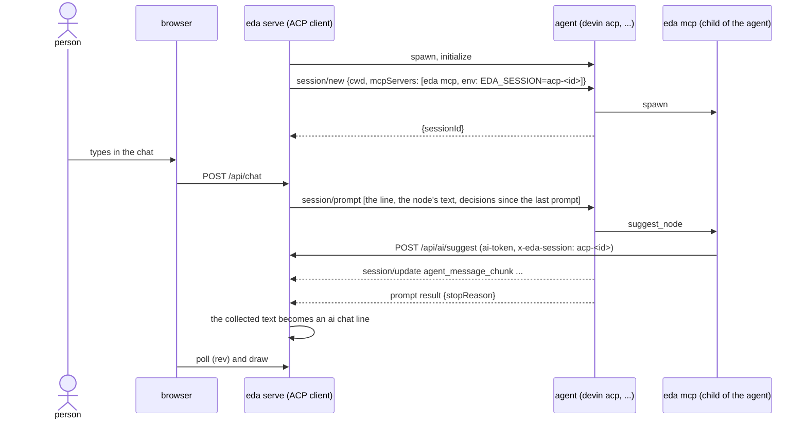

# Talking to the map through ACP, next to the channel (roadmap)

Status: deferred. Not built now; kept as the plan for when ACP agents make it easier (see Revisit when). kaneo eda#53.

## Background

- Request (kaneo eda#53, verbatim): 「acp って eda で使えるかな。mcp channel 便利なんですが、claude code の preview なんで acp が使えるならそっちのがいいかなと」「ACP が合ってよさそうだな。」
- Today the person's chat reaches the AI only through Claude Code's channel (`notifications/claude/channel`), which Claude Code ships as a research preview behind `--dangerously-load-development-channels`. Only Claude Code can be the AI.
- ACP (Agent Client Protocol) is JSON-RPC over stdio between a client and an agent it starts as a child process. Agents that speak it on this host: `devin acp`, `opencode acp`, `gemini --acp`, `qwen --acp`, `goose acp`, `copilot --acp`; Claude Code through the adapter `@agentclientprotocol/claude-agent-acp`.

## Conclusion

- Not now. The channel stays the only way in. The owner chose to stop here after the measurements below (2026-11-08: 「ACP いったんやめていい気がしてきたな。ロードマップてきな感じで書いておいてもらおうかな。今後 拡充されて色々やりやすくなる可能性あり。。。」).
- The main reason: an ACP agent brings its own file and shell tools and its own MCP servers, and eda's answers to its permission requests do not stop it from writing (measured below). ACP mode would give no better guarantee than the channel does, with more moving parts.
- And less visibility: in channel mode the person sees the AI's tool calls in their own Claude Code session; in ACP mode as planned, the agent's tool calls are not shown, so what it did reaches the person only as its own account in the chat.
- The rest of this document is the plan if it is picked up again.

## The plan

- Two modes, both kept as first-class: **channel mode** (today: the map talks to the Claude Code session that started it) and **ACP mode** (`eda serve` starts one agent per map as its ACP client and talks to it on the person's behalf). Neither replaces the other; which one fits depends on the case (see Choosing a mode).
- The agent gets `eda mcp` as an MCP server in `session/new`, so it uses the same four tools (read, suggest a node, suggest a change, reply) with the same `ai-token`. The rule does not change: one suggestion is one node or one change, three wait at most, only the person adopts.
- The person's chat line becomes a `session/prompt`; the agent's answer text becomes the AI's chat line. An adopt or reject is told to the agent in the next prompt rather than in a turn of its own.
- The AI still cannot write to the map for the same reason as today: the MCP server holds only `ai-token`. Answering the agent's permission requests does not add to that guarantee (measured below), so it is not claimed.
- A map has either a channel session or an ACP agent talking to it, or both; they are separate sessions with separate suggestion slots.

## What was measured

On d1, 2026-11-08, with a throwaway `EDA_HOME` and map, a probe client spoke ACP v1 to the agent (one run each, not repeated):

| Check | devin acp 3000.12.28 | opencode acp 2.2.5 |
|---|---|---|
| `initialize` (`protocolVersion: 1`, no fs / terminal capabilities) | ok | ok |
| `session/new` with `mcpServers: [eda mcp]` and `env` | connected, listed the 4 tools | ok |
| `session/prompt` | answered in 10 s | refused: its default model's provider was not logged in |
| eda tool calls with `x-eda-session` from the `env` passed in `session/new` | `read_map` and `suggest_node` reached the throwaway map; the suggestion was recorded under that session | not reached |
| `session/request_permission` for eda's tools | asked for each (`_meta.cognition.ai/permissionRule: mcp__eda__read_map`) | not reached |
| Rejecting a shell write in the workspace | rejected, then the agent wrote the same file with its file-write tool **without asking** | not reached |
| MCP servers in the session | eda **plus** every server from the person's own agent config (ccx, akapen, jellyfin, outline, …) | not reached |

- So answering permission requests is not a boundary: an agent decides which calls it asks about, and one that runs in a bypass mode asks about none.
- And the agent is not limited to eda's tools: it brings its own tools and its own MCP servers.

## Choosing a mode

| | channel mode | ACP mode |
|---|---|---|
| Who the AI is | the Claude Code session the person is already in | an agent eda starts (devin, opencode, …) |
| Started by | the session running `eda serve` | `eda serve --agent <name>` (picked per map) |
| Conversation | the person's existing one: what the session already knows is there | a new one per `eda serve` start; it knows the map only through the tools |
| Startup cost | none beyond the session already running | a new agent process and its own startup context (its instructions, its config's MCP servers) once per start |
| Per-message cost | one channel event in a long conversation | one prompt turn; the agent's prefix is re-read each turn, mostly from its prompt cache (devin: 34,304 of 34,448 input tokens cached on one probe turn) |
| Depends on | Claude Code's channel preview flag | the agent speaking ACP |

- Channel mode fits a map that grows out of work already going on in a session, and keeps the token cost of a session that is running anyway.
- ACP mode fits a map started on its own, an AI other than Claude Code, or a host where the preview flag is not wanted.
- What the agent reads at startup (its instructions files, the person's profile) is the agent's own config, not something eda passes. eda adds only its MCP server and the prompts. A devin that imports the Claude Code config (`read_config_from`) brings those files and MCP servers with it.

## Flow

## The agent

- Configured per host in `~/.config/eda/config.json` as named argv lists, `"agents": { "devin": ["devin", "acp"] }`; `eda serve <dir> --agent <name>` picks one. No `--agent`, no agent: the map works as today. The key names the agent, not the protocol, because the agent is what the person picks.
- Started at the first chat line, not at `eda serve`, so a map that is only looked at costs no agent process.
- Runs with `cwd` set to the map directory's parent, never the map directory itself, so a relative write the agent makes on its own does not land on `eda.json`. This narrows a mistake; it does not stop a deliberate write (see Known limits).
- Its environment is `eda serve`'s minus `KANEO_API_KEY`: the agent reads the person's map and the web, and a key it never needs should not be in its reach.
- Login is the agent's own (`devin auth login`, `opencode auth login`). An agent that answers "authentication required" is shown in the chat as that message and is not retried.
- Stopped with `eda serve`. A crash is shown in the chat once; the next chat line starts it again.

## The session key

- `eda mcp` reads its session from `CLAUDE_CODE_SESSION_ID` today. For an agent, eda passes `EDA_SESSION=acp-<id>` (a random id) in the `env` of the MCP server it hands to `session/new`; `eda mcp` reads `EDA_SESSION` first.
- eda makes the key itself because the agent's `sessionId` is only known after `session/new`, and the MCP server is part of that request.
- The key is recorded in the map's `sessions` like a Claude Code session, with `kind: "acp"`, `agent` (its name) and `acpSessionId` (the agent's `sessionId`). Its `eda mcp` does not run the channel loop: messages reach the agent as prompts.

## Prompts

- One prompt at a time per agent, as ACP requires. Lines typed while a turn runs are queued and sent together as the next prompt, in order.
- A prompt carries the person's lines (each with its node's text, as the channel does today) and the adopt / reject notes about this agent's own suggestions since its last prompt. A decision alone does not start a turn: it waits for the next line, so adopting three suggestions does not cost three turns.
- The text from `agent_message_chunk` is collected until the prompt result and posted as one ai chat line. Tool-call updates are not shown. An agent that also calls `reply` posts a second line; that is left as it is.
- A stop button in the chat sends `session/cancel` for the running turn.

## Permission requests

- eda answers `allow_once` when the request names one of eda's own tools and `reject_once` for anything else. Naming is agent-specific: devin puts `mcp__eda__<tool>` in `_meta.cognition.ai/permissionRule`; an agent eda cannot read this from gets every request rejected and is shown as such in the chat.
- This keeps a well-behaved agent from running a shell or editing files without the person seeing it in the chat. It is not what keeps the AI from writing to the map (see Conclusion).

## README and the contribution rule

- The README's "the same Claude Code session" stays true for the channel and gains a second paragraph for agents. The contribution rule is unchanged.

## Revisit when

Any one of these makes ACP mode worth building; check them against the agent's current version first.

- An agent can be started over ACP with no tools of its own and only the MCP servers the client passes. `devin acp --agent-type summarizer` is a tool-less profile by devin's own `--help`; whether it still uses the passed MCP servers is not measured.
- Permission answers become a boundary: the agent asks before every write and does not retry a rejected write through another tool.
- An agent's config import can be turned off per ACP session, so the person's own MCP servers do not come along (devin: `read_config_from`, per host today).
- Claude Code's channel leaves preview or changes shape, so the channel mode itself needs a replacement.
- Claude Code through `claude-agent-acp` is measured with the person's bypass setting.

## Open questions for when this is picked up

From the review of PR #51; each needs an answer in the doc before building.

- Both modes on one map: does `--agent` turn off channel delivery for that map, or do both AIs get every line? How does the chat tell their lines apart?
- The session key's lifetime: per `eda serve` run, per agent process or per `session/new`; and what happens to an old key's undecided suggestions after a crash or restart (they keep using slots under a key no agent holds).
- The agent's environment: an allowlist (`PATH`, `HOME`, locale) rather than removing `KANEO_API_KEY` alone, since the agent's imported config carries other credentials anyway. `eda mcp` reads `ai-token` from `$EDA_HOME` (default `~/.eda`), not from the environment, so it does not lose anything.
- A turn's end: show `stopReason` other than `end_turn` (refusal, max tokens, cancelled); a turn timeout; what a cancel does to partial text and queued lines.
- Failure kinds: spawn failure, authentication required, protocol error and a crash mid-turn each need their own handling, not one "crash" bucket.
- Provenance: what goes in an adopted node's `model` when the agent does not report one.
- Where the data goes: picking an agent picks the vendor that receives the map and the chat; say so in Choosing a mode.
- Permission answers for agents whose requests eda cannot read: rejecting everything makes eda's own tools unusable.

## Known limits

- An agent runs as the same OS user as `eda serve`. It can read `$EDA_HOME/token` and write `eda.json` with its own tools, as a Claude Code session with a shell can today (0001). The permission answers above do not change that, and the agent may not ask at all.
- The agent brings its own MCP servers and tools, not only eda's.
- Claude Code through `claude-agent-acp` is not measured: the adapter is not installed here. Whether it asks for permission under the person's bypass setting is unknown.
- One agent per map. Two maps open with agents are two agent processes.

## Not in this slice

- Resuming an agent's conversation after `eda serve` restarts (`session/load` / `session/resume`). The first slice starts a new ACP session each time; the map, its chat and its suggestions are kept as today.
- Showing tool calls, plans or thinking in the chat.
- Letting the person answer permission requests from the map.
- Removing the channel.
